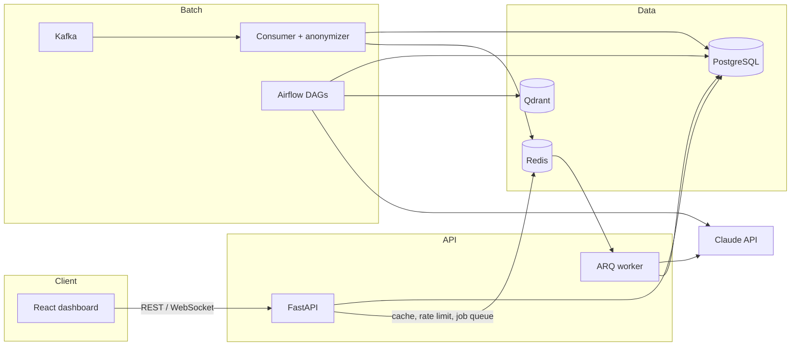
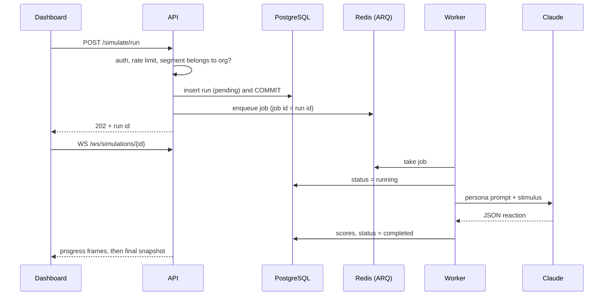

# Architecture

How the Synthetic Persona Sandbox is built, how a request moves through it, and where its
boundaries are. For tooling and conventions see [ENGINEERING.md](ENGINEERING.md); for the
model side see [APPLIED_AI.md](APPLIED_AI.md).

## System overview

Two paths reach the model. The **interactive path** (dashboard → API → queue → worker) is
what users click through. The **batch path** (Airflow DAGs) runs feature engineering and
embeddings, and can run simulations with behavioral data.

## Components

| Component | Path | Responsibility |
|-----------|------|----------------|
| Dashboard | `dashboard/` | Segment builder, campaign launcher, live progress, results, analytics, admin |
| API | `api/` | Authentication, tenancy, CRUD, job submission, progress stream, metrics |
| Worker | `api/workers/simulation_worker.py` | Runs persona inference and writes the result |
| Ingestion | `ingestion/` | Kafka producers and consumer, PII anonymization, Avro schemas, dead-letter queue |
| ML | `ml/` | Feature engineering, embeddings, persona prompt, scoring, evaluation |
| Orchestration | `orchestration/` | Airflow DAGs and a Kafka lag sensor |
| Infrastructure | `infra/` | Dockerfiles, Kubernetes manifests, Terraform, Prometheus and Grafana |

## Request flows

### Asynchronous simulation (the dashboard path)

Details that matter:

- The row is **committed before** the job is enqueued. Otherwise a fast worker can update a
  row that isn't visible yet and change nothing.
- If the queue is down, the run is marked `failed` with `QUEUE_UNAVAILABLE` and the API
  returns 503, so no orphan `pending` rows are left.
- The worker runs the blocking model call in a thread. Up to `SIMULATION_MAX_CONCURRENT`
  jobs (default 5) run at once, each with a 120-second timeout. A timed-out job is marked
  `failed` with `WORKER_TIMEOUT`.
- The WebSocket checks the run's status once a second with a short-lived database session,
  sends a snapshot, and closes when the run completes or fails.

### Synchronous simulation

`POST /simulate/run/sync` does the same work inside the request and returns 201 when done.
It exists for tests and batch callers. It is **not rate limited**.

### Ingestion

1. Producers publish page-view, purchase and session events to Kafka, validated against
   Avro schemas.
2. The consumer anonymizes each event **before it is stored**: user ids and emails become
   HMAC-SHA256 hashes, IPv4 addresses are cut to their first three octets, and IPv6
   addresses are dropped.
3. Events are inserted into `behavioral_events`. A duplicate `event_id` is ignored and does
   not double-count the profile.
4. Live profile counters (page views, purchases, spend, sessions) are updated in Redis.
5. Malformed messages go to a dead-letter topic instead of stopping the consumer.

### Batch pipelines (Airflow)

| DAG | Schedule | What it does |
|-----|----------|--------------|
| `extract_segment_data` | Manual | Feature engineering for a segment, then an embedding stored in Qdrant |
| `run_simulation_pipeline` | Manual | Waits for Kafka lag to drain, computes features, runs inference **with** behavioral aggregates, stores the run |
| `variant_competition` | Manual | Runs several variants against one segment and ranks them |
| `drift_check` | Daily 03:00 UTC | Flags segments not retrained in 7 days |
| `hello_world` | Manual | Smoke test for the Airflow setup |

## Data model

| Table | Holds | Migration |
|-------|-------|-----------|
| `users` | Platform users | 001 |
| `segments` | Name, description, JSON definition, staleness, last trained | 001 |
| `simulation_runs` | Stimulus, reaction, sentiment, scores, model metadata, status | 001, 003 |
| `behavioral_events` | Anonymized events, unique by `event_id` | 002 |
| `campaigns`, `campaign_variants` | Campaigns, their variants, rank and linked run | 003 |
| `organizations`, `org_members`, `api_keys`, `audit_events` | Tenancy and access | 004 |

Migration 004 adds `org_id` to every tenant table. Migrations are plain SQL, written to be
safe to re-run, and applied in file order.

A run's status moves `pending → running → completed | failed`.

## Caching and limits

| Item | Where | Lifetime |
|------|-------|----------|
| Completed run | Redis, key scoped by organization | 24 hours |
| Organization info | Redis | 5 minutes |
| Rate limit | Redis, per organization per clock minute | 60 async simulation requests per minute by default |
| Model replies | Disk (`data/cache`), keyed by model, prompts and settings | Until deleted |

Only completed runs are cached, because their results never change. Deleting an
organization's data also clears its cached runs. If Redis is down, the rate limiter lets
requests through rather than blocking simulations.

## Security and tenancy

**Authentication.** Requests carry a bearer JWT or an `X-API-Key`. API keys are random,
shown once, and stored only as a SHA-256 hash. With `AUTH_REQUIRED=false`, the local
default, every request runs as an admin guest in a default organization.

**Roles.**

| Role | Can |
|------|-----|
| `viewer` | Read segments, campaigns and simulation results |
| `analyst` | Viewer, plus read the audit log |
| `marketer` | Analyst, plus write segments and campaigns, run simulations, list API keys |
| `admin` | Everything, including members, API keys and deleting the organization's data |

**Tenant isolation** is enforced in application code: every query filters on the token's
`org_id`. PostgreSQL row-level security is not used, so a missed filter would leak data.
The regression suite includes a cross-tenant test.

**Production guards.** With `ENV=production`, startup fails if the JWT secret is a known
default or shorter than 32 characters, ingestion fails if `PII_SALT` is the development
salt, the dev-token endpoint is disabled, and the admin seed and clear endpoints refuse.

**Audit.** Every write request (POST, PUT, PATCH, DELETE) that passed authentication is
recorded in `audit_events` after the response, with its status code. A failed audit write
is logged and does not fail the request.

**Not implemented.** Tokens are verified with a shared secret (HS256). Verifying RS256
tokens from an external identity provider through JWKS is not implemented.

## Failure behavior

| Failure | Effect |
|---------|--------|
| Redis down at API startup | API starts; the queue connection is retried when first needed |
| Queue unavailable on submit | Run marked `failed`, API returns 503 |
| Model error or invalid JSON | Run marked `failed` with the error |
| Worker timeout | Run marked `failed` with `WORKER_TIMEOUT` |
| Redis down for the rate limiter | Requests allowed |
| Malformed Kafka message | Sent to the dead-letter topic |
| Kafka lag not drained | The simulation DAG continues after about a minute and logs a warning |

## Observability

The API exposes Prometheus metrics at `/metrics`:

| Metric | Meaning |
|--------|---------|
| `spb_api_request_latency_seconds` | Latency by method, route template and status |
| `spb_simulation_requests_total` | Submitted simulations by stimulus type |
| `spb_simulation_latency_seconds` | Worker time per simulation |
| `spb_simulation_errors_total` | Failures by error type |
| `spb_simulation_queue_depth` | Jobs waiting, read from Redis when scraped |

Alert rules cover latency and error-rate SLO burn, queue depth, and the API being down.
Dashboards are provisioned in `infra/docker/grafana/`.

## Deployment

`infra/k8s/` defines the API, worker and dashboard (2 replicas each). Autoscaling runs the
API at 2–10 replicas and the worker at 2–8. Also included: ingress with TLS and security
headers, monitoring, and a nightly PostgreSQL backup to S3. `.github/workflows/deploy.yml`
builds images and deploys on pushes to `main` and on version tags.

## Known architectural gaps

1. **The interactive path doesn't use behavioral data.** Only the `run_simulation_pipeline`
   DAG passes behavioral aggregates to the prompt.
2. Qdrant embeddings are written but never read during inference.
3. Tenant isolation depends on every query remembering its filter.
4. The synchronous endpoint can run up model costs without a rate limit.
